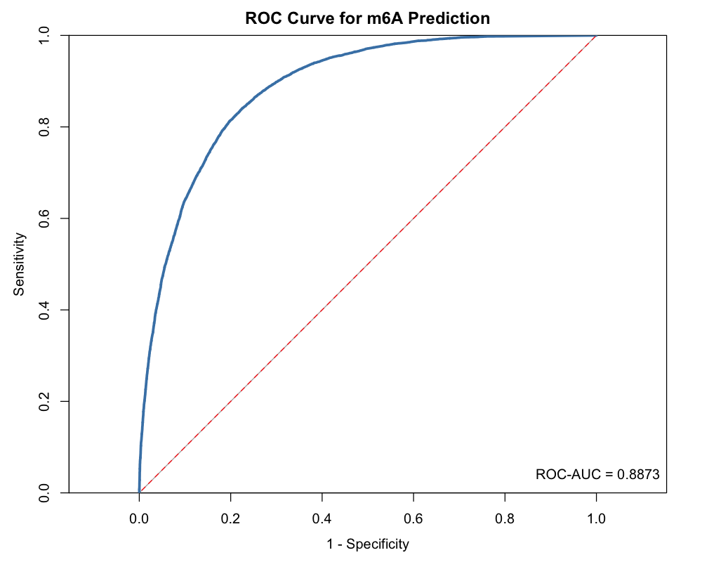
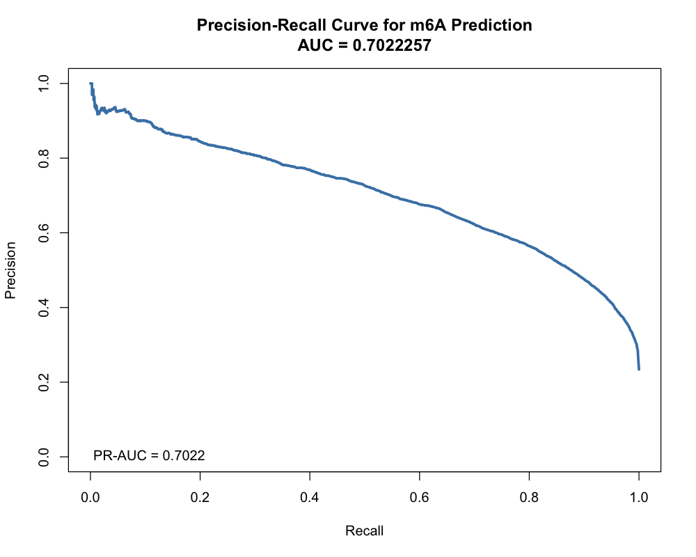
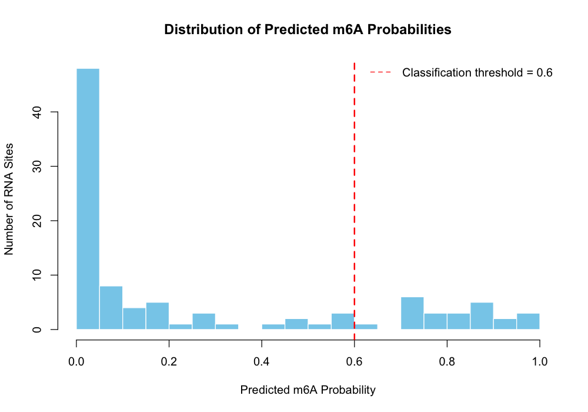

# m6APrediction

## Overview

`m6APrediction` is an R package for predicting RNA m6A modification sites using a pre-trained Random Forest model. Users can provide sequence information and other RNA-related features to predict whether a site is likely to be modified. The package supports both single-site and multiple-site predictions, and returns the predicted probability and modification status for each site.

## Main Features

The package contains three main functions:

- `dna_encoding()`: Converts DNA sequences into nucleotide features that can be used by the prediction model.
- `prediction_single()`: Predicts the m6A modification probability and status for one RNA site.
- `prediction_multiple()`: Makes predictions for multiple RNA sites from an input data frame.

Users can also change the probability threshold to adjust how sites are classified as positive or negative.

## Installation

The package can be installed from GitHub using the `remotes` package.

```r
install.packages("remotes")
remotes::install_github("YOUR_GITHUB_USERNAME/m6APrediction")
```

After installation, load the package:

```r
library(m6APrediction)
```

Replace `YOUR_GITHUB_USERNAME` with the actual GitHub username.

## How to Use

The package includes a trained Random Forest model and an example dataset, so users can try the prediction functions without preparing their own data first.

### 1. Load the Model

First, load the Random Forest model included in the package.

```r
rf_fit <- readRDS(system.file(
  "extdata", "rf_fit.rds",
  package = "m6APrediction"
))
```

### 2. Predict a Single RNA Site

The `prediction_single()` function takes several RNA-related features as input, including GC content, RNA type, RNA region, exon length, distance to junction, evolutionary conservation and a DNA 5-mer sequence.

For example:

```r
prediction_single(
  ml_fit = rf_fit,
  gc_content = 0.6,
  RNA_type = "mRNA",
  RNA_region = "CDS",
  exon_length = 12,
  distance_to_junction = 5,
  evolutionary_conservation = 0.8,
  DNA_5mer = "GGACA",
  positive_threshold = 0.5
)
```

The output from this example is:

```text
predicted_m6A_prob   predicted_m6A_status
"0.51"               "Positive"
```

The model gives this site a predicted m6A probability of 0.51. Since this is higher than the threshold of 0.5, the site is classified as Positive.

### 3. Predict Multiple RNA Sites

For multiple-site prediction, users can provide a data frame containing the required features.

The package includes an example CSV file:

```r
example_data <- read.csv(system.file(
  "extdata", "m6A_input_example.csv",
  package = "m6APrediction"
))
```

We can then predict the modification status of all sites:

```r
results <- prediction_multiple(
  ml_fit = rf_fit,
  feature_df = example_data,
  positive_threshold = 0.6
)

head(results)
```

The output keeps the original input features and adds two columns:

- `predicted_m6A_prob`: The predicted probability of m6A modification.
- `predicted_m6A_status`: Whether the site is classified as Positive or Negative.

In this example, the threshold is set to 0.6, meaning that sites with a predicted probability above 0.6 are classified as Positive.

### 4. DNA Sequence Encoding

The `dna_encoding()` function converts DNA sequences into separate nucleotide positions.

For example:

```r
dna_encoding(c("GGACA", "AGACT"))
```

Each position is stored as a categorical feature. This allows the Random Forest model to use the sequence information together with other RNA-related features.

## Scientific Significance

N6-methyladenosine (m6A) is a common RNA modification that plays a role in RNA regulation and gene expression. Identifying potential m6A sites can help researchers better understand RNA modification patterns.

However, experimentally identifying these sites can require considerable time and resources. Computational prediction provides another way to identify candidate sites for further investigation.

This package uses a Random Forest model to make predictions based on sequence information and other biological features. It also allows users to predict multiple sites at once, which may be useful when working with larger datasets.

The predictions are based on a trained model and should be treated as computational estimates rather than experimental confirmation.

## Model Performance

The Random Forest model was evaluated using out-of-bag (OOB) predictions from 48,055 RNA sites. These predictions are generated using trees that did not include the corresponding samples during training.

### ROC Curve

The model achieved a ROC-AUC of 0.8873, suggesting that it can distinguish reasonably well between positive and negative m6A sites.



### Precision-Recall Curve

The model achieved a PR-AUC of 0.7022. The Precision-Recall curve shows the relationship between precision and recall when identifying positive m6A sites.



Both results are based on OOB predictions rather than an independent test dataset.

### Predicted m6A Probability Distribution

The following figure shows the distribution of predicted m6A probabilities for the example dataset. The red dashed line indicates the classification threshold of 0.6.



## Author

Lingqin Meng

## License

This package is available under the MIT License.
